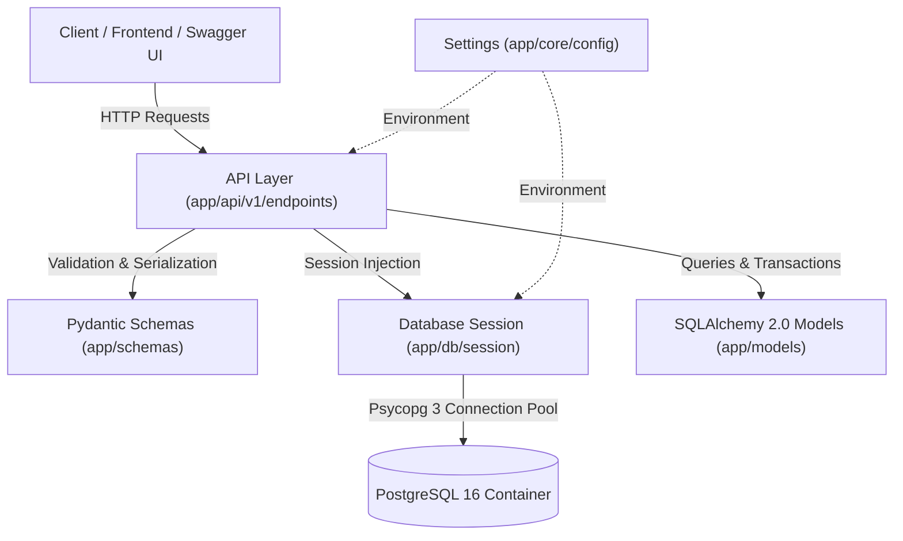

# FastAPI + PostgreSQL Production Library Management System

A production-grade RESTful API built with **FastAPI**, **PostgreSQL 16**, **SQLAlchemy 2.0**, and **Alembic**, designed with **Clean Layered Architecture** principles, resilient connection pooling, multi-book borrowing workflows, automated late fine calculation, and multi-layer database security guards.

---

## 🌟 Key Features

* **Clean Layered Architecture**: Strict separation of concerns across Configuration, Database Sessions, Domain Models, Pydantic DTOs, and API Route Handlers.
* **Student Library Management**:
  * **Student Registration**: Manage student profiles with validation.
  * **Inventory Management**: Track books with total and available copy counts.
  * **Multi-Book Checkout**: Students can borrow multiple books simultaneously in an atomic transaction.
  * **Automated Late Fine Calculation**: Dynamic assessment of overdue returns at **₹50 per day**.
* **Todo CRUD Resource**: Full CRUD demonstration with pagination and partial updates.
* **Database Version Control (Alembic)**: Fully automated schema migrations synchronized with SQLAlchemy models.
* **Resilient Connection Pooling**: PostgreSQL 16 integration via **Psycopg 3** driver with `pool_pre_ping=True`, permanent connection pools, and overflow handling.
* **Two-Layer Database Safety Guard**:
  * **Lifecycle PreToolUse Hook**: Intercepts and blocks destructive CLI commands (`DROP TABLE`, `TRUNCATE`, `alembic downgrade`).
  * **SQLAlchemy Runtime Guard**: Intercepts and denies destructive DDL executions at the ORM engine level.
* **Interactive API Documentation**: Auto-generated Swagger UI and ReDoc specifications.

---

## 🏗️ Project Architecture



---

## 📁 Repository Structure

```text
FastApi_Postgress/
├── .agents/                  # Customization hooks & safety guards
│   ├── hooks.json            # Antigravity PreToolUse lifecycle hook
│   └── scripts/
│       └── db_guard.py       # Shell command safety inspection script
├── alembic/                  # Database migration scripts
│   ├── env.py                # Migration runner using app settings & metadata
│   └── versions/             # Migration version history
├── app/
│   ├── main.py               # FastAPI application entrypoint & lifespan
│   ├── core/
│   │   └── config.py         # Pydantic Settings & environment loader
│   ├── db/
│   │   ├── base.py           # SQLAlchemy DeclarativeBase
│   │   ├── guard.py          # SQLAlchemy runtime DDL safety listener
│   │   └── session.py        # Engine, connection pooling, get_db dependency
│   ├── models/               # SQLAlchemy ORM domain entities
│   │   ├── book.py           # Books inventory table
│   │   ├── book_issue.py     # Borrow transactions & fine records
│   │   ├── student.py        # Students table
│   │   └── todo.py           # Todos table
│   ├── schemas/              # Pydantic request/response validation schemas
│   │   ├── book.py
│   │   ├── book_issue.py
│   │   ├── student.py
│   │   └── todo.py
│   └── api/
│       └── v1/
│           ├── __init__.py   # Router aggregator (/api/v1)
│           └── endpoints/    # REST route handlers
│               ├── books.py
│               ├── library.py
│               ├── students.py
│               └── todos.py
├── docs/                     # Authoritative system documentation
│   ├── ARCHITECTURE.md       # Architectural blueprints & layer guides
│   ├── DATABASE.md           # Schema definitions, ER diagram, pooling guide
│   ├── GOVERNANCE.md         # Multi-agent development governance rules
│   ├── PROJECT_CONTEXT.md    # Capabilities & technical stack
│   └── TASK_TRACKER.md       # Milestone history & roadmap
├── .env.example              # Environment variables template
├── .gitignore                # Git exclusions
├── AGENTS.md                 # Universal AI agent onboarding guide
├── CLAUDE.md                 # Claude Code CLI configuration
├── docker-compose.yml        # PostgreSQL 16 & pgAdmin 4 services
├── README.md                 # Main project documentation
└── requirements.txt          # Pinned project dependencies
```

---

## 🚀 Quick Start Guide

### 1. Prerequisites
* **Python**: 3.12+
* **Docker & Docker Compose**: Installed and running

### 2. Clone & Setup Virtual Environment
```bash
git clone <your-repository-url>
cd FastApi_Postgress

# Create and activate virtual environment
python3 -m venv .venv
source .venv/bin/activate
```

### 3. Install Dependencies
```bash
pip install -r requirements.txt
```

### 4. Configure Environment
Copy the example environment template:
```bash
cp .env.example .env
```
*(Default settings connect to local Docker PostgreSQL on port 5432).*

### 5. Launch PostgreSQL & pgAdmin
Start containerized services in detached mode:
```bash
docker compose up -d
```

### 6. Apply Database Migrations
Run Alembic to apply all migrations to PostgreSQL:
```bash
alembic upgrade head
```

### 7. Start the FastAPI Development Server
```bash
uvicorn app.main:app --reload --port 8000
```

---

## 📖 API Documentation & Endpoints

Once the server is running, explore interactive documentation:
* **Swagger UI**: [http://localhost:8000/docs](http://localhost:8000/docs)
* **ReDoc**: [http://localhost:8000/redoc](http://localhost:8000/redoc)
* **Health Check**: [http://localhost:8000/health](http://localhost:8000/health)

### Key Endpoints

| Category | Method | Endpoint | Description |
| :--- | :--- | :--- | :--- |
| **Students** | `POST` | `/api/v1/students/` | Register a new student profile |
| | `GET` | `/api/v1/students/` | List all registered students (paginated) |
| | `GET` | `/api/v1/students/{id}` | Get student details by ID |
| **Books** | `POST` | `/api/v1/books/` | Add a book to inventory with copy count |
| | `GET` | `/api/v1/books/` | View all books and available copies |
| | `GET` | `/api/v1/books/{id}` | Get specific book details |
| **Library** | `POST` | `/api/v1/library/borrow` | Borrow multiple books at once (`book_ids: [...]`) |
| | `POST` | `/api/v1/library/return/{issue_id}` | Return book, restore copies, and calculate late fine (₹50/day) |
| | `GET` | `/api/v1/library/issues` | View active and historical borrowing records |
| **Todos** | `POST` | `/api/v1/todos/` | Create a todo item |
| | `GET` | `/api/v1/todos/` | List paginated todos |
| | `PUT` | `/api/v1/todos/{id}` | Update todo status/content |
| | `DELETE`| `/api/v1/todos/{id}` | Delete a todo |

---

## 🔒 Security & Database Guard Policy

1. **PreToolUse Hook**: `.agents/hooks.json` intercepts automated agent terminal sessions and hard-blocks commands containing `DROP TABLE`, `DROP DATABASE`, `TRUNCATE`, or `alembic downgrade`.
2. **Runtime Engine Hook**: `app/db/guard.py` listens to SQLAlchemy engine executions and raises a `PermissionError` if raw destructive SQL statements are attempted.
3. **No Plaintext Passwords**: Database credentials and sensitive secrets are kept in `.env` (gitignored).

---

## 🛠️ Developer Commands

| Task | Command |
| :--- | :--- |
| **Start Server** | `uvicorn app.main:app --reload --port 8000` |
| **Start Containers**| `docker compose up -d` |
| **Stop Containers** | `docker compose down` |
| **Generate Migration** | `alembic revision --autogenerate -m "description"` |
| **Apply Migrations** | `alembic upgrade head` |
| **Rollback Migration** | `alembic downgrade -1` |

---

## 📄 License
This project is open-source and available under the MIT License.
