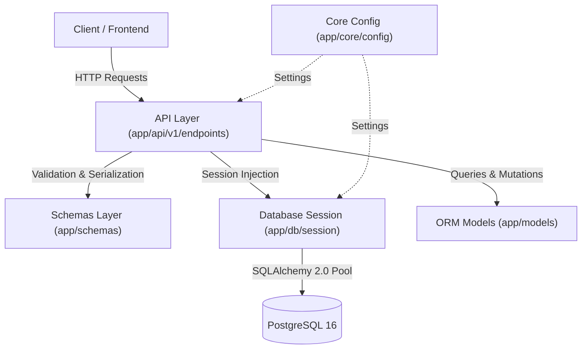

# Project Architecture

## Design Principles
This project adheres to **Clean Architecture** and **Layered Architecture** principles, prioritizing modularity, maintainability, and testability.



## Directory Structure & Responsibilities

```text
app/
├── core/
│   └── config.py        # Environment variables & runtime settings (Pydantic Settings)
├── db/
│   ├── base.py          # SQLAlchemy DeclarativeBase
│   └── session.py       # Engine creation, connection pooling, get_db dependency
├── models/
│   ├── __init__.py      # Model registry for Alembic/metadata discovery
│   └── todo.py          # SQLAlchemy 2.0 ORM domain entities (tables)
├── schemas/
│   ├── __init__.py      # DTO exports
│   └── todo.py          # Pydantic schemas (Request body & Response models)
├── api/
│   ├── v1/
│   │   ├── endpoints/   # Route handlers by resource
│   │   │   └── todos.py # Todo CRUD endpoints
│   │   └── __init__.py  # Sub-router aggregation
│   └── __init__.py
└── main.py              # Application factory, lifespan, middleware, routers
```

## Layer Interactions
1. **API Layer (`app/api/`)**:
   - Handles HTTP routing, path parameters, query parameters, and status codes.
   - Depends on the `get_db` generator to receive an isolated database session per request.
   - Relies on Pydantic schemas for request validation and response filtering.
2. **Data Access Layer (`app/db/` & `app/models/`)**:
   - Defines table definitions and relationships using SQLAlchemy 2.0 typed mappings.
   - `get_db()` ensures transaction scoping: commits/rollbacks and guarantees `session.close()` in a `finally` block to prevent connection leaks.
3. **Configuration Layer (`app/core/`)**:
   - Centralizes all configuration into strongly-typed `Settings` loaded from `.env`.
