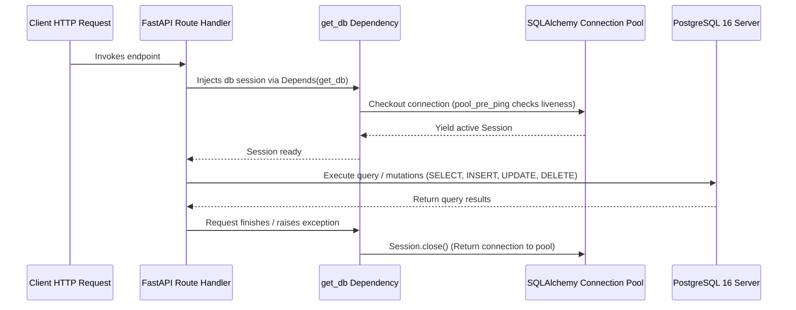

# Database Architecture & PostgreSQL Integration

## Overview
PostgreSQL is integrated via SQLAlchemy 2.0 with the modern **psycopg** (version 3) DBAPI driver.

## Connection Lifecycle & Pooling


## Key Engine Configurations
* **`pool_pre_ping=True`**: Before handing a connection to the application, SQLAlchemy issues an optimistic test ping (`SELECT 1`). If the database restarted or the socket dropped, the dead connection is recycled seamlessly rather than throwing a `500 Server Error`.
* **`pool_size=10`**: Maintains 10 persistent connections ready in memory to avoid the high latency cost of repeated TCP handshakes and TLS negotiations.
* **`max_overflow=20`**: Allows burst traffic of up to 20 additional connections during peak loads.

## Migrations Workflow with Alembic
1. **Generating a migration after changing models**:
   ```bash
   .venv/bin/alembic revision --autogenerate -m "describe_changes_here"
   ```
2. **Reviewing generated migration**:
   Always inspect the generated file under `alembic/versions/` before applying.
3. **Applying migrations**:
   ```bash
   .venv/bin/alembic upgrade head
   ```
4. **Rollback migration**:
   ```bash
   .venv/bin/alembic downgrade -1
   ```

## Schema Entities
### `todos` Table
| Column | Type | Constraints | Description |
| :--- | :--- | :--- | :--- |
| `id` | `INTEGER` | Primary Key, Indexed | Unique identifier |
| `content` | `VARCHAR(500)` | Non-nullable | Text description of the task |
| `is_completed`| `BOOLEAN` | Non-nullable, Default: `false` | Status flag |
| `created_at` | `TIMESTAMP WITH TIME ZONE` | Non-nullable, Server Default: `now()` | Timestamp of creation |
| `updated_at` | `TIMESTAMP WITH TIME ZONE` | Non-nullable, Server Default: `now()` | Timestamp of last modification |

### `students` Table
| Column | Type | Constraints | Description |
| :--- | :--- | :--- | :--- |
| `id` | `INTEGER` | Primary Key, Indexed | Unique student identifier |
| `name` | `VARCHAR(100)` | Non-nullable | Full name of student |
| `address` | `VARCHAR(255)` | Non-nullable | Residential address |
| `age` | `INTEGER` | Nullable | Student age |
| `created_at` | `TIMESTAMP WITH TIME ZONE` | Non-nullable, Server Default: `now()` | Timestamp of enrollment |
| `updated_at` | `TIMESTAMP WITH TIME ZONE` | Non-nullable, Server Default: `now()` | Timestamp of last modification |

### `books` Table
| Column | Type | Constraints | Description |
| :--- | :--- | :--- | :--- |
| `id` | `INTEGER` | Primary Key, Indexed | Unique book identifier |
| `title` | `VARCHAR(200)` | Non-nullable | Title of the book |
| `author` | `VARCHAR(100)` | Non-nullable | Author name |
| `isbn` | `VARCHAR(20)` | Unique, Nullable | ISBN code |
| `total_copies` | `INTEGER` | Non-nullable, Default: 1 | Total inventory copies |
| `available_copies` | `INTEGER` | Non-nullable, Default: 1 | Currently unborrowed copies |
| `created_at` | `TIMESTAMP WITH TIME ZONE` | Non-nullable, Server Default: `now()` | Added to inventory timestamp |

### `book_issues` Table (Many-to-Many Borrowing & Fines)
| Column | Type | Constraints | Description |
| :--- | :--- | :--- | :--- |
| `id` | `INTEGER` | Primary Key, Indexed | Unique borrow record identifier |
| `student_id` | `INTEGER` | Foreign Key (`students.id`), Indexed | Borrower student ID |
| `book_id` | `INTEGER` | Foreign Key (`books.id`), Indexed | Borrowed book ID |
| `issued_at` | `TIMESTAMP WITH TIME ZONE` | Non-nullable, Server Default: `now()` | Checkout timestamp |
| `due_date` | `TIMESTAMP WITH TIME ZONE` | Non-nullable | Deadline to return |
| `returned_at` | `TIMESTAMP WITH TIME ZONE` | Nullable | Check-in timestamp |
| `fine_amount` | `INTEGER` | Non-nullable, Default: 0 | Calculated late fee (₹50/day overdue) |
| `status` | `VARCHAR(20)` | Non-nullable, Default: `BORROWED` | `BORROWED` or `RETURNED` |

## Database Safety Guard & Destruction Prevention
1. **Agent Lifecycle PreToolUse Hook (`.agents/hooks.json` & `.agents/scripts/db_guard.py`)**:
   Intercepts agent tool executions before running commands. Blocks commands matching destructive patterns (`DROP TABLE`, `DROP DATABASE`, `TRUNCATE`, `alembic downgrade`, `docker volume rm`).
2. **SQLAlchemy DDL Event Listener (`app/db/guard.py`)**:
   Listens to the SQLAlchemy engine on `before_execute` and raises `PermissionError` if any raw query attempts a destructive drop or truncate at runtime.
